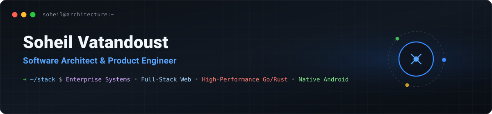

  

<h3 dir="rtl">«مسئله رو می‌شناسم، راه‌حلش رو می‌سازم!»</h3>

  <a href="README.md">English</a> &middot; <strong dir="rtl">نسخه فارسی</strong>

  
  
  
  

---

<h3>حوزه‌های تمرکز مهندسی</h3>

سیستم‌های نرم‌افزاری را از لایه معماری تا پیاده‌سازی نهایی طراحی و اجرا می‌کنم؛ از سرویس‌های بک‌اند پرسرعت و موتورهای تحلیلی تا اپلیکیشن‌های بومی اندروید و پلتفرم‌های ابری.

<ul>
  <li><strong>سامانه‌های اختصاصی سازمانی و کسب‌وکار:</strong> طراحی و ساخت CRM اختصاصی، مدیریت سفارش و موجودی، کارتابل‌های عملیاتی و داشبوردهای گزارش‌گیری لحظه‌ای برای حذف اکسل‌های پراکنده.</li>
  <li><strong>ابزارهای تحلیلی و اپلیکیشن‌های نیتیو:</strong> موتورهای پردازش و پایش ۲۴ ساعته بازار، ربات‌های تحلیلی و اپلیکیشن‌های اندروید و دسکتاپ آفلاین‌محور با پایداری بالا.</li>
  <li><strong>وب‌اپلیکیشن‌ها و پلتفرم‌های مدرن:</strong> توسعه پلتفرم‌های وب، سیستم‌های نوبت‌دهی، پورتال مشتریان، وب‌سایت‌های سئومحور و PWA روی همه دستگاه‌ها.</li>
  <li><strong>ربات‌ها و مینی‌اپ‌های تعاملی تلگرام:</strong> ساخت اکوسیستم‌های فروش، ثبت‌نام، گزارش‌گیری تیمی و اتصال مستقیم ربات‌ها و Mini-Appها به CRM و فرآیندهای داخلی.</li>
</ul>

---

<h3>پروژه‌های شاخص عمومی</h3>

<h4><a href="https://github.com/xSOH3ILx/Gahshomar">Gahshomar (گاه‌شمار خورشیدی)</a></h4>

  
  
  
  
  

اپلیکیشن ماژولار تقویم جلالی برای اندروید با موتور یادآور دقیق خورشیدی، مهاجرت امن دیتابیس Room، پنج ویجت Material 3 و همگام‌سازی iCalendar (<code>.ics</code>).

<h4><a href="https://github.com/xSOH3ILx/TeleRich-Standalone">TeleRich-Standalone</a></h4>

  
  
  
  
  

استودیوی ساخت پیام‌های پیشرفته تلگرام و موتور ربات بدون سرور روی Cloudflare Workers با پیش‌نمایش زنده Markdown و HTML، بهبودهای امنیتی و تست‌های Playwright.

<h4><a href="https://github.com/xSOH3ILx/Gnome-PersianCalendar">Gnome-PersianCalendar</a></h4>

  
  
  
  
  

افزونه تقویم هجری شمسی برای میزکار GNOME Shell نسخه‌های ۴۶ تا ۵۰ با پنجره تنظیمات GTK4/Libadwaita، اتصال به Google Calendar و تست‌های خودکار GJS روی D-Bus.

<h4><a href="https://github.com/xSOH3ILx/paQQet">paQQet</a></h4>

  
  
  

ابزار مدیریت تانل‌های چندمسیره مبتنی بر پاکت خام (<code>paqet</code> و پروتکل KCP) روی لینوکس با زنجیره‌های فایروال پایدار، بهینه‌سازی BBR و کرنل، واچ‌داگ ترافیک و HAProxy.

---

<h3>پروژه‌های تجاری و محرمانه (NDA)</h3>

<blockquote>
  
<strong>تعهدنامه محرمانگی و مخازن خصوصی:</strong> بخش عمده سیستم‌های سازمانی، مالی و تجاری من در <strong>مخازن خصوصی</strong> تحت قراردادهای عدم افشا (NDA) قرار دارند. استاندارد معماری ماژولار، تست‌پذیری و کدنویسی تمیز در مخازن عمومی، نمونه مستقیم همین رویکرد در پروژه‌های تجاری است.

</blockquote>

  
<strong>تفکیک دامنه فناوری در مخازن عمومی و سیستم‌های خصوصی</strong>

  <ul>
    <li><strong>مخازن عمومی (Kotlin، TypeScript، JavaScript، Bash):</strong> اپلیکیشن‌های ماژولار اندروید و Jetpack Compose، سرویس‌های بدون سرور Cloudflare Workers، افزونه‌های میزکار گنوم و خودکارسازی شبکه در لینوکس.</li>
    <li><strong>سیستم‌های تجاری و خصوصی (Go، Rust، Python، Next.js، Vue، PostgreSQL):</strong>
      <ul>
        <li><strong>Go و Rust:</strong> سیستم‌های با تاخیر پایین، پردازش تراکنش‌ها، اسکنرها و موتورهای تحلیل میکرواستراکچر بازار.</li>
        <li><strong>Python و FastAPI:</strong> میکروسرویس‌ها، سرویس‌های گزارش‌گیری و موتورهای پردازش داده.</li>
        <li><strong>Next.js، React و Vue.js:</strong> پورتال‌های سازمانی، CRM اختصاصی، سیستم‌های رزرواسیون و وب‌اپلیکیشن‌های PWA.</li>
        <li><strong>PostgreSQL، Prisma و Redis:</strong> مدل‌سازی رابطه‌ای داده، مایگریشن‌های امن، کشینگ و بهینه‌سازی کوئری‌ها.</li>
      </ul>
    </li>
  </ul>

---

<h3>جعبه‌ابزار فنی</h3>

<strong>موبایل</strong>

  
  
  
  

<strong>وب و فرانت‌اند</strong>

  
  
  
  
  

<strong>بک‌اند و سیستم</strong>

  
  
  
  
  

<strong>پایگاه‌داده و زیرساخت</strong>

  
  
  
  
  
  
  
  

---

<h3>پویایی فعالیت‌های گیت‌هاب</h3>

  <picture>
    <source media="(prefers-color-scheme: dark)" srcset="https://raw.githubusercontent.com/xSOH3ILx/xSOH3ILx/output/github-contribution-grid-snake-dark.svg" />
    <source media="(prefers-color-scheme: light)" srcset="https://raw.githubusercontent.com/xSOH3ILx/xSOH3ILx/output/github-contribution-grid-snake.svg" />
    
  </picture>

---

  © ۱۴۰۵ سهیل وطن‌دوست &middot; طراحی‌شده با دقت مهندسی

