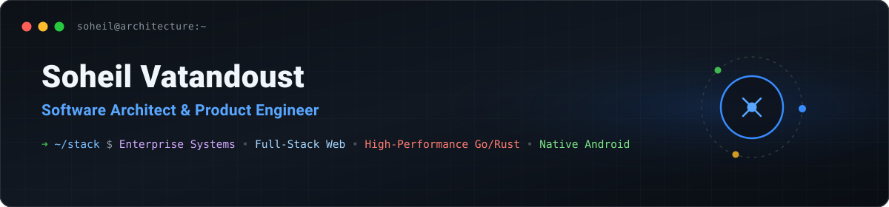

  

<h3>&ldquo;I understand the problem. I build the solution.&rdquo;</h3>

  <strong>English</strong> &middot; <a href="README.fa.md" dir="rtl">نسخه فارسی</a>

  
  
  
  

---

### Engineering Focus

I design and ship resilient, end-to-end software systems—from high-throughput backend services and financial/analytical engines to native Android apps and serverless web platforms.

- **Business &amp; Enterprise Systems:** Custom CRMs, inventory and order workflows, internal team portals, and real-time BI reporting replacing fragmented spreadsheets.
- **Analytical Engines &amp; Native Software:** 24/7 market scanners, automated trading systems, offline-first Android apps, and hardware-integrated desktop utilities.
- **Modern Web Platforms &amp; PWAs:** SEO-ready corporate sites, booking systems, customer portals, and responsive progressive web applications.
- **Telegram Ecosystems &amp; Mini-Apps:** Interactive Telegram Mini-Apps and bots integrated directly with CRMs, operational reporting, and payment/booking flows.

---

### Featured Public Work

#### [Gahshomar](https://github.com/xSOH3ILx/Gahshomar)

  
  
  
  
  

Modular native Android Persian (Jalali) calendar with a zero-drift solar recurring reminder engine, Room database migrations, 5 Material 3 home widgets, and iCalendar (<code>.ics</code>) sync.

#### [TeleRich-Standalone](https://github.com/xSOH3ILx/TeleRich-Standalone)

  
  
  
  
  

Serverless Telegram rich-messaging studio and bot engine deployed on Cloudflare Workers, featuring live Markdown/HTML preview, security hardening, and Playwright end-to-end coverage.

#### [Gnome-PersianCalendar](https://github.com/xSOH3ILx/Gnome-PersianCalendar)

  
  
  
  
  

Persian (Jalali) solar calendar extension for GNOME Shell 46–50 with GTK4/Libadwaita preferences, GNOME Online Accounts / Google Calendar integration, and automated GJS D-Bus tests.

---

### Commercial &amp; NDA Engineering Scope

> **Confidential Client Work:** Most of my production backend, financial, and enterprise systems live in **private repositories under commercial NDAs**. My public repositories demonstrate the same modular architecture, testing discipline, and maintainable code standards across mobile, serverless, desktop, and Linux environments.

  
<strong>Public Showcase vs. Private NDA Systems Breakdown</strong>

- **Public Repositories (Kotlin, TypeScript, JavaScript, Bash)**
  - Native Android multi-module architecture, Jetpack Compose, Room migrations, exact alarm scheduling
  - Serverless edge applications on Cloudflare Workers, React/Vite UIs, Telegram Bot API
  - Linux desktop integration (GNOME Shell / GTK4 / D-Bus) and raw-packet network automation
- **Private &amp; NDA Production Systems (Go, Rust, Python, Next.js, Vue, PostgreSQL)**
  - **Go &amp; Rust:** Low-latency transaction pipelines, 24/7 market microstructure engines, and concurrent scanners
  - **Python &amp; FastAPI:** High-throughput microservices, analytical backends, and automated reporting services
  - **TypeScript / Next.js / Vue.js:** Enterprise portals, custom CRMs, booking marketplaces, and PWAs
  - **PostgreSQL, Prisma &amp; Redis:** Relational schema design, safe migrations, caching, and query optimization

---

### Tech Stack

**Mobile**

  
  
  
  

**Web &amp; Frontend**

  
  
  
  
  

**Backend &amp; Systems**

  
  
  
  
  

**Databases &amp; Infrastructure**

  
  
  
  
  
  
  
  

---

### GitHub Activity

  <picture>
    <source media="(prefers-color-scheme: dark)" srcset="https://raw.githubusercontent.com/xSOH3ILx/xSOH3ILx/output/github-contribution-grid-snake-dark.svg" />
    <source media="(prefers-color-scheme: light)" srcset="https://raw.githubusercontent.com/xSOH3ILx/xSOH3ILx/output/github-contribution-grid-snake.svg" />
    
  </picture>

---

  &copy; 2026 Soheil Vatandoust &middot; Built with engineering precision

